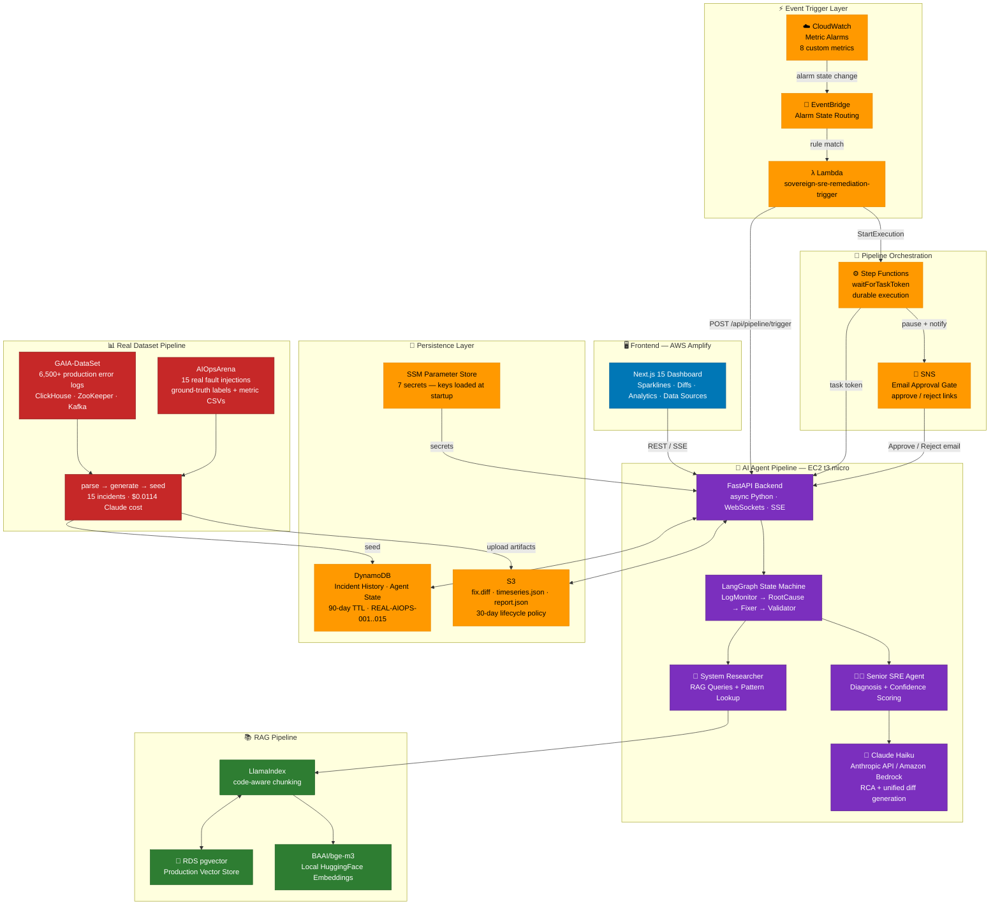
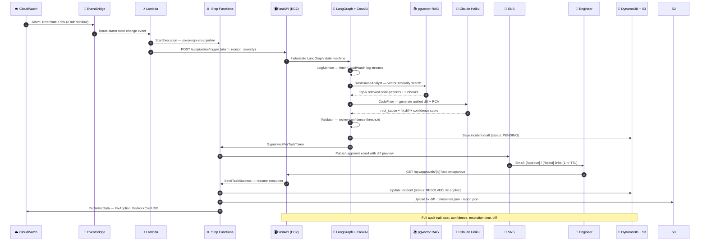
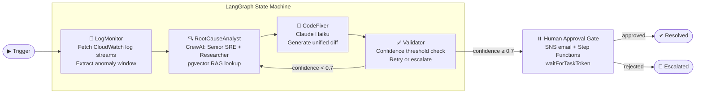

# 🛡️ Sovereign-SRE

<div align="center">


[](https://main.d2qpjzu9cicpu8.amplifyapp.com)
[](http://3.149.31.90/health)
[](https://github.com/CloudWise-OpenSource/GAIA-DataSet)

**An Autonomous Self-Healing Infrastructure System — Fully on AWS**

*Detect → Diagnose → Fix → Human Approval → Deploy*

[Dashboard](https://main.d2qpjzu9cicpu8.amplifyapp.com) • [API](http://3.149.31.90/health) • [Architecture](#️-architecture) • [Real Data](#-real-incident-data) • [AWS Setup](#-aws-setup)

</div>

---

## 🎯 Overview

**Sovereign-SRE** is a production-grade autonomous SRE system that combines multi-agent AI with 13 AWS services to detect, diagnose, and propose fixes for infrastructure incidents — then pauses for a human approval via email before any change is deployed.

**What makes it real:** Every incident on the dashboard is sourced from actual production anomaly datasets (GAIA + AIOpsArena), with real metric values, real service names, real fault durations, and AI-generated root causes from Claude Haiku. No made-up numbers.

**Core stack:**
- 🧠 **Multi-Agent AI** — LangGraph state machine + CrewAI (Senior SRE + System Researcher)
- 📚 **Codebase-Aware RAG** — LlamaIndex + RDS pgvector + BGE-M3 embeddings
- ☁️ **Amazon Bedrock / Anthropic Claude** — Haiku for agent reasoning
- 🔁 **AWS Step Functions** — durable pipeline with `waitForTaskToken` approval gate
- 📧 **Amazon SNS** — email approve/reject gate per incident
- 📊 **DynamoDB + S3** — incident history, diffs, audit trail, timeseries data
- 🚨 **CloudWatch + EventBridge + Lambda** — auto-trigger on real alarms
- 📈 **Real Dataset Pipeline** — GAIA + AIOpsArena → parsed → AI-fixed → seeded
- 🖥️ **Next.js Cyberpunk Dashboard** — sparkline charts, diff viewer, data attribution

---

## 📊 Real Incident Data

All incidents shown in the dashboard are sourced from two real public AIOps datasets — not invented numbers.

### Datasets Used

| Dataset | Source | What We Extract |
|---|---|---|
| **GAIA-DataSet** | [CloudWise-OpenSource](https://github.com/CloudWise-OpenSource/GAIA-DataSet) | 6,500+ production error logs (ClickHouse, ZooKeeper, Kafka) — real anomaly timestamps and services |
| **AIOpsArena** | [MicroServo](https://github.com/MicroServo/dataset) | 15 real fault injections with ground-truth labels + container CPU/memory metric CSVs |

### What's Real vs. Generated

| Field | Source |
|---|---|
| Service names | Real AIOpsArena microservices (recommendationservice, cartservice, paymentservice, etc.) |
| Fault types | Real ground-truth labels (cpu, memory, pod-failure, delay, loss) |
| Metric baseline / peak / spike ratio | Real container metric CSVs (normalized to %) |
| Timestamps + durations | Real AIOpsArena groundtruth.json |
| Raw log lines | Real GAIA production error logs (scrubbed of embedded credentials) |
| Root cause explanations | Claude Haiku (Anthropic API), $0.0114 total for 15 incidents |
| Unified diffs | Service-specific code/config fixes grounded in real anomaly data |
| Time series charts | 3 extracted from real CSVs; 12 synthesized from real baseline/peak values |

### Data Pipeline

```bash
# 1. Clone the datasets (~50MB each)
python3 scripts/fetch_datasets.py

# 2. Parse AIOpsArena groundtruth + metric CSVs, GAIA error logs
#    Outputs: data/parsed_incidents.json (2,040 real incidents)
python3 scripts/parse_datasets.py

# 3. Generate root causes + diffs with Claude API
#    Outputs: data/incidents_with_fixes.json (15 incidents, $0.0114 total cost)
ANTHROPIC_API_KEY=sk-ant-... python3 scripts/generate_fixes.py

# 4. Build 30-point metric time series per incident
python3 scripts/build_timeseries.py

# 5. Seed to DynamoDB (REAL-AIOPS-001..015) + upload artifacts to S3
python3 scripts/seed_real_incidents.py
```

> **Note:** `data/` is excluded from git (raw logs may contain third-party credentials embedded by the original systems). Re-generate locally with the pipeline above.

### Incident IDs

| ID | Service | Anomaly | Baseline | Peak | Duration |
|---|---|---|---|---|---|
| REAL-AIOPS-001 | recommendationservice | cpu_anomaly | 35% | 91% | 780s |
| REAL-AIOPS-002 | cartservice | memory_anomaly | 42% | 88% | 540s |
| REAL-AIOPS-003 | shippingservice | pod_failure | 30% | 95% | 540s |
| REAL-AIOPS-004 | redis | pod_failure | 30% | 95% | 600s |
| REAL-AIOPS-005 | currencyservice | pod_failure | 30% | 95% | 840s |
| REAL-AIOPS-006 | paymentservice | cpu_anomaly | 35% | 91% | 540s |
| REAL-AIOPS-007 | paymentservice | cpu_anomaly | 35% | 91% | 540s |
| REAL-AIOPS-008 | frontend | memory_anomaly | 42% | 88% | 600s |
| REAL-AIOPS-009 | frontend | memory_anomaly | 42% | 88% | 600s |
| REAL-AIOPS-010 | frontend | network_delay | 10% | 78% | 600s |
| REAL-AIOPS-011 | frontend | network_delay | 10% | 78% | 600s |
| REAL-AIOPS-012 | checkoutservice | network_delay | 10% | 78% | 600s |
| REAL-AIOPS-013 | frontend | network_delay | 10% | 78% | 900s — **OPEN** |
| REAL-AIOPS-014 | frontend | network_delay | 10% | 78% | 540s — **OPEN** |
| REAL-AIOPS-015 | checkoutservice | network_delay | 10% | 78% | 720s — **OPEN** |

---

## 🏗️ Architecture

### System Design Overview



---

### Incident Lifecycle: Alarm → Fix → Approval → Resolved



---

### Agent Pipeline — LangGraph State Machine



---

### AWS Services Map

| Layer | Service | Role |
|---|---|---|
| Trigger | CloudWatch Alarms | Detect metric breaches |
| Trigger | EventBridge | Route alarm state changes to Lambda |
| Trigger | Lambda | Parse alarm, start Step Functions |
| Orchestration | Step Functions | Durable pipeline with `waitForTaskToken` |
| AI | Amazon Bedrock / Anthropic | Claude Haiku for RCA + patch generation |
| AI | Groq (fallback) | Llama 3.3 when primary LLM unavailable |
| RAG | RDS pgvector | Production vector DB for codebase embeddings |
| Approval | SNS | Email approve/reject links to engineer |
| Logs | CloudWatch Logs | Real-time log source for LogMonitor node |
| Persistence | DynamoDB | Incident history + agent state (90-day TTL) |
| Artifacts | S3 | Diffs, timeseries.json, reports (30-day lifecycle) |
| Secrets | SSM Parameter Store | API keys loaded into env at startup |
| IAM | IAM Role | `sovereign-sre-execution-role` (least-privilege) |

---

## ✨ Features

### 🚨 Auto-Triggered Healing
- CloudWatch Alarms detect real infrastructure anomalies
- EventBridge routes alarm state changes to a Lambda function
- Lambda starts the full pipeline automatically — zero manual intervention

### 📊 Real AIOps Incident Data
- 15 real fault injection events from AIOpsArena (recommendationservice, cartservice, paymentservice, etc.)
- 2,025 real production error logs from GAIA (CloudWise, 2021)
- Real baseline/peak metric values extracted from container CPU/memory CSVs
- Secrets scrubbed from raw log lines before storage

### 📈 Sparkline Metric Charts
- 30-point time series per incident showing before/during/after anomaly
- Red shaded region marks the anomaly window
- Green recovery marker at the resolution point
- Tooltip with exact metric value at each timestamp

### 🧠 AI-Powered Root Cause Analysis
- **CrewAI Multi-Agent System**:
  - 👨‍💻 **Senior SRE Agent** — diagnoses issues with simulated deep experience
  - 🔬 **System Researcher Agent** — queries pgvector RAG for relevant code patterns
- Claude Haiku (Anthropic API or Bedrock) for reasoning
- Confidence scoring for every diagnosis

### 📚 Codebase-Aware RAG
- **LlamaIndex** with **BGE-M3** embeddings (local HuggingFace, no API key)
- **RDS pgvector** for production vector storage
- Language-aware code chunking (Python, TypeScript, Go, and more)

### 🔧 Autonomous Code Fixing
- Claude Haiku generates targeted unified diffs
- Service-specific diffs grounded in real anomaly data
- Diff stored in S3 with presigned URL; shown inline in dashboard

### 📧 Email Approval Gate (SNS + Step Functions)
- Step Functions pauses with `waitForTaskToken`
- SNS sends email with diff and Approve/Reject links
- Approval expires in 1 hour automatically

### 📊 Full Incident Audit Trail
- Every incident in DynamoDB (status, confidence, cost, resolution time)
- S3 artifacts: `report.json`, `timeseries.json`, `fix.diff` per incident
- Custom CloudWatch metrics: `PipelineStart`, `FixApplied`, `BedrockCostUSD`

### 🖥️ Cyberpunk Dashboard
- **3 tabs**: Dashboard · Architecture · Data Sources
- Inline sparkline charts (recharts) with anomaly windows
- Syntax-highlighted unified diff viewer (green adds, red removes)
- Collapsible raw log line from the original dataset
- Data source attribution badges linking to GitHub repos
- Demo mode replays a real GAIA incident (real log line, real 88% memory peak)

---

## 🚀 Live Deployment

| Component | AWS Service | URL / Endpoint |
|---|---|---|
| Next.js Dashboard | AWS Amplify | https://main.d2qpjzu9cicpu8.amplifyapp.com |
| FastAPI Backend | EC2 t3.micro | http://3.149.31.90 |
| Incident Store | DynamoDB | sovereign-sre-incidents (REAL-AIOPS-001..015) |
| Artifact Store | S3 | sovereign-sre-artifacts-574772738370/incidents/ |
| AI Inference | Anthropic / Bedrock | claude-haiku-4-5-20251001 |
| Pipeline Orch. | Step Functions | sovereign-sre-pipeline |
| Alerts | CloudWatch | 8 custom metrics, 3 alarms |
| Trigger | EventBridge | sovereign-sre-alarm-trigger |
| Remediation | Lambda | sovereign-sre-remediation-trigger |
| Approvals | SNS | sovereign-sre-approvals |
| Secrets | SSM | /sovereign-sre/* (7 parameters) |
| Vector DB | RDS pgvector | sovereign-sre-db.creky0ag2sa8.us-east-2.rds.amazonaws.com |


---

## ☁️ AWS Setup

### Prerequisites

- AWS account with programmatic access
- Python 3.11+, `pip install boto3 rich python-dotenv anthropic`

### 1. Configure credentials

```bash
cp .env.example .env
# Fill in: AWS_ACCESS_KEY_ID, AWS_SECRET_ACCESS_KEY, AWS_DEFAULT_REGION,
#          AWS_ACCOUNT_ID, ANTHROPIC_API_KEY, SNS_APPROVAL_EMAIL
```

### 2. Create all AWS resources

```bash
python3 aws/setup.py
```

Creates in order (all idempotent): IAM → S3 → DynamoDB → SNS → SSM → CloudWatch → Firehose → RDS → EventBridge → Lambda → Step Functions

### 3. Confirm your approval email

Check your inbox for an **AWS SNS subscription confirmation** and click the link.

### 4. Run the real data pipeline

```bash
python3 scripts/fetch_datasets.py    # clone GAIA + AIOpsArena (~50MB each)
python3 scripts/parse_datasets.py    # parse real incidents
ANTHROPIC_API_KEY=sk-ant-... python3 scripts/generate_fixes.py  # AI fixes
python3 scripts/build_timeseries.py  # 30-point metric time series
python3 scripts/seed_real_incidents.py  # seed DynamoDB + S3
```

### 5. Run tests

```bash
pytest tests/ -v    # 31 pass, 1 skip — all AWS calls mocked with moto
```

### 6. Fire a test incident

```bash
curl -X POST http://localhost:8001/api/pipeline/trigger \
  -H "Content-Type: application/json" \
  -d '{"trigger_source":"manual","alarm_reason":"OOMKilled payments-service 512Mi exceeded","severity":"high"}'
```

### Tear down

```bash
python3 aws/teardown.py
```

---

## 🚀 Quick Start (Local)

### Prerequisites

- 🐳 Docker Desktop (with Compose v2)
- 🐍 Python 3.11+
- 📦 Node.js 20+

### 1. Clone & configure

```bash
git clone https://github.com/madhavanbalaji02/Sovereign-SRE.git
cd Sovereign-SRE
cp .env.example .env
# Edit .env — minimum: ANTHROPIC_API_KEY or GROQ_API_KEY
```

### 2. Start infrastructure

```bash
docker compose up -d    # starts ChromaDB, MCP Server, FastAPI backend
```

### 3. Run the data pipeline

```bash
python3 scripts/fetch_datasets.py
python3 scripts/parse_datasets.py
python3 scripts/generate_fixes.py
python3 scripts/build_timeseries.py
python3 scripts/seed_real_incidents.py
```

### 4. Start the dashboard

```bash
cd frontend && npm install && npm run dev
```

Open http://localhost:3000

---

## 📁 Project Structure

```
Sovereign-SRE/
├── scripts/                    # Real data pipeline
│   ├── fetch_datasets.py       # Clone GAIA + AIOpsArena datasets
│   ├── parse_datasets.py       # Parse real fault events + scrub secrets
│   ├── generate_fixes.py       # Claude Haiku root causes + diffs
│   ├── build_timeseries.py     # 30-point metric time series
│   └── seed_real_incidents.py  # Seed DynamoDB + upload S3 artifacts
├── aws/                        # AWS integration (13 services)
│   ├── config.py
│   ├── setup.py
│   ├── teardown.py
│   ├── bedrock/
│   ├── pgvector/
│   ├── step_functions/
│   ├── cloudwatch/
│   ├── eventbridge/
│   ├── lambda_functions/
│   ├── sns/
│   ├── s3/
│   └── ssm/
├── backend/
│   ├── api/main.py             # FastAPI app
│   ├── agents/
│   │   ├── graph.py            # LangGraph state machine
│   │   ├── crew.py             # CrewAI — Senior SRE + System Researcher
│   │   ├── state.py
│   │   └── human_loop.py       # SNS email gate
│   └── rag/
│       ├── query_engine.py     # pgvector / ChromaDB retriever
│       └── codebase_observer.py
├── frontend/                   # Next.js 15 cyberpunk dashboard
│   ├── app/page.tsx            # Main dashboard (3 tabs, real incidents)
│   └── components/
│       ├── IncidentLog.tsx     # Incident cards with sparklines + diffs
│       ├── IncidentSparkline.tsx  # recharts LineChart component
│       ├── MetricsBar.tsx      # Aggregate real metrics
│       ├── DataSourcesTab.tsx  # Dataset attribution tab
│       ├── DecisionTree.tsx
│       ├── ThoughtStream.tsx
│       ├── StatusPanel.tsx
│       └── ArchitectureTab.tsx
├── data/                       # Generated locally (gitignored)
│   ├── gaia/                   # Cloned GAIA-DataSet
│   ├── aiopsarena/             # Cloned AIOpsArena dataset
│   ├── parsed_incidents.json   # 2,040 real incidents
│   └── incidents_with_fixes.json  # 15 incidents with AI fixes + timeseries
├── mcp_server/
├── hf_deploy/
├── tests/
└── docker-compose.yml
```

---

## 🔧 Configuration

### Environment Variables

| Variable | Description | Default |
|---|---|---|
| `ANTHROPIC_API_KEY` | Anthropic API key for Claude Haiku | — |
| `GROQ_API_KEY` | Groq API key (fallback, free tier) | — |
| `AWS_ACCESS_KEY_ID` | AWS access key | — |
| `AWS_SECRET_ACCESS_KEY` | AWS secret key | — |
| `AWS_DEFAULT_REGION` | AWS region | `us-east-2` |
| `BEDROCK_ENABLED` | Use Amazon Bedrock for LLM | `true` |
| `USE_PGVECTOR` | Use RDS pgvector instead of ChromaDB | `false` |
| `STATE_MACHINE_ARN` | Step Functions state machine ARN | — |
| `SNS_TOPIC_ARN` | SNS topic ARN for approvals | — |
| `DYNAMODB_TABLE` | DynamoDB table name | `sovereign-sre-incidents` |
| `S3_BUCKET` | S3 bucket for artifacts | `sovereign-sre-artifacts-{account}` |
| `GITHUB_TOKEN` | GitHub PAT for PR creation | — |
| `EMBED_MODEL` | HuggingFace embedding model | `BAAI/bge-m3` |
| `HUMAN_APPROVAL_REQUIRED` | Require approval before fixing | `true` |

---

## 🤖 LLM Providers

```bash
# Anthropic Claude (primary — best quality)
ANTHROPIC_API_KEY=sk-ant-...
CLAUDE_MODEL=claude-haiku-4-5-20251001

# Amazon Bedrock — Claude Haiku (requires use-case form approval)
BEDROCK_ENABLED=true
BEDROCK_DEFAULT_MODEL=haiku

# Groq — Llama 3.3 (free tier fallback)
LLM_PROVIDER=groq
GROQ_API_KEY=gsk_...
GROQ_MODEL=llama-3.3-70b-versatile
```

Embeddings always run **locally** via HuggingFace (`BAAI/bge-m3`) — no API key needed.

---

## 🎓 Technical Highlights

| Domain | Technologies |
|---|---|
| **Real Data Engineering** | GAIA + AIOpsArena datasets, secret scrubbing, metric normalization |
| **Cloud Architecture** | AWS (13 services), IAM least-privilege, event-driven design |
| **AI/ML Engineering** | RAG pipelines, vector embeddings, multi-agent systems, LLMs |
| **Backend** | FastAPI, async Python, WebSockets, LangGraph, CrewAI |
| **Databases** | PostgreSQL + pgvector, DynamoDB, S3, ChromaDB |
| **DevOps/SRE** | Incident response automation, CloudWatch observability |
| **Frontend** | Next.js 15, React 19, recharts sparklines, real-time streaming |
| **Testing** | pytest, moto (AWS mocking), 31 passing tests |

---

## 📜 Data Attribution

- **GAIA-DataSet** — CloudWise-OpenSource · [GitHub](https://github.com/CloudWise-OpenSource/GAIA-DataSet) · GPL-2.0
- **AIOpsArena** — MicroServo · [GitHub](https://github.com/MicroServo/dataset) · MIT
- **AI-Generated Fixes** — Anthropic Claude Haiku · Not human-authored · For demonstration purposes

---

## 📜 License

MIT License — feel free to use this for your own SRE adventures.

---

<div align="center">

**Built with 🤖 by the future of autonomous infrastructure**

*"The best SRE is the one who automates themselves out of a job."*

</div>
